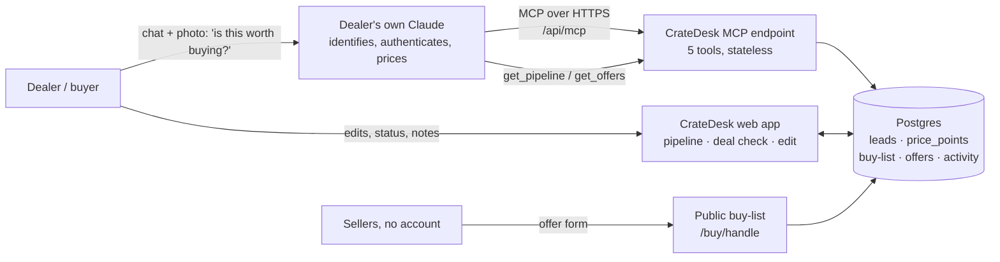

# CrateDesk

**The buying desk for collectibles dealers in India: retro gaming, vinyl and trading cards. It runs on the dealer's own Claude, and the app itself contains no AI.**

Dealers and resale shops source stock from OLX, Instagram, WhatsApp groups, estate sales and walk-ins. Every buy is a judgment call: what exactly is this, is it real, and what will it resell for? Today that knowledge sits in the owner's head and in WhatsApp threads.

With CrateDesk, the dealer's Claude reads the listing, photo or seller message, identifies the item and edition, flags authenticity and condition risks, and estimates a resale range in INR. It sends this to CrateDesk over MCP. CrateDesk runs the procurement side of the business:
- a **sourcing pipeline** with deterministic margin checks against the dealer's target margin
- **price/cost history**
- team **editing and status tracking**
- a public **"We're buying" page** where sellers submit offers 24/7

## Connect it to Claude

1. In Claude, go to **Settings → Connectors** (also under **Customize → Connectors**).
2. Click **Add custom connector**. Name it `CrateDesk` and paste `https://<your-app>/api/mcp`. No OAuth is needed.
3. In a new chat, switch on CrateDesk in the tools menu.
4. Try: *"Someone on OLX in Pune is selling a boxed PAL Super Nintendo with 2 controllers for ₹9,000. Add it to my CrateDesk pipeline and tell me if it's worth buying for resale."* You can also paste a screenshot or a photo of a record sleeve.
5. Open the app. The lead is in the pipeline with its margin. Edit it, then ask Claude to "review my pipeline" and it sees your edits.

Test login: `volopay` / `crate2026`. Public page: `/buy/groove-and-pixel` (the demo dealer is fictional).

| Tool | What it does |
|---|---|
| `add_lead` | Save an item to buy, with Claude's identification, resale range and risk notes |
| `update_lead` | Change asking price (logged to history), status, estimate or notes |
| `get_pipeline` | Read leads, computed margins and the team's edits (filter by category/status) |
| `add_to_buylist` | Add an item to the public "We're buying" page |
| `get_offers` | Read offers sellers submitted on the buy-list |

## Architecture



**Data flow.** Claude → MCP tool call → validation (zod) → Postgres → pipeline UI. The team's edits go back to Postgres, and Claude reads them on the next `get_pipeline` call. Sellers write offers through the public page, and Claude reads them with `get_offers` to compare against max price and resale value.

**Who does what**

| The dealer's Claude (dealer pays) | CrateDesk (we pay hosting only) |
|---|---|
| Reading photos, screenshots, listing text | Storing leads, price history, buy-list, offers |
| Identifying item, edition, pressing, set | Margin calc: resale midpoint vs asking vs target margin → Buy / Negotiate / Pass, max buy price |
| Spotting fakes and condition risks | Team editing, status pipeline, activity log (who did what: Claude / team / seller) |
| Estimating Indian resale value, comparing offers | Public buy-list and seller offer intake, live 24/7 |

**No AI inside.** The app has no OpenAI or Anthropic keys and makes no model calls. Margin, verdict and max-buy price are arithmetic.

## Stack

Next.js 15 (App Router, server actions) · Postgres (Neon via Vercel) via `postgres.js` · `@modelcontextprotocol/sdk` 1.32 with the Web-standard Streamable HTTP transport (stateless, JSON responses) · zod · hosted on Vercel. Tables are created automatically on the first request.

## Built vs proposed

| Built (v1, live) | Proposed (production) |
|---|---|
| One dealer per deployment, one shared test login | Multi-tenant workspaces, roles (owner/buyer), per-workspace MCP URL with OAuth |
| MCP endpoint is open (no auth) for easy reviewer testing | OAuth 2.1 on the MCP endpoint |
| Resale ranges come from Claude and the team | Proprietary INR price index from accepted offers and bought/sold prices across dealers |
| Margin vs a single target (env `TARGET_MARGIN`, default 30%) | Per-category targets, sell-side tracking (realised margin), inventory ageing |
| Offers stored in-app | WhatsApp/email alerts on new offers, payouts to sellers, spend controls and cards for buyers |

**Simulated or limited in v1:** nothing in the demo flow is mocked. The demo dealer "Groove & Pixel Collectibles" is fictional. Limitations: single tenant, unauthenticated MCP endpoint, no notifications, and resale estimates are Claude's judgment rather than a market dataset.

**Assumptions:** the dealer already uses Claude (Free allows one custom connector; Pro and up allow several). Indian collectibles supply is fragmented across OLX, Instagram and WhatsApp, with no INR price reference.

## Run locally

```bash
cp .env.example .env.local   # set DATABASE_URL to any Postgres
npm install && npm run dev
```

## Deploy (Vercel)

1. Push this repo to GitHub, then in Vercel choose **Add New → Project** and import it.
2. In the project, go to **Storage → Create Database → Neon (Postgres)** and connect it. `DATABASE_URL` is added automatically.
3. Optional env vars: `DEMO_USER`, `DEMO_PASSWORD`, `DEALER_HANDLE`, `DEALER_NAME`, `DEALER_CITY`, `TARGET_MARGIN`.
4. Redeploy. The MCP URL is `https://<project>.vercel.app/api/mcp`.
