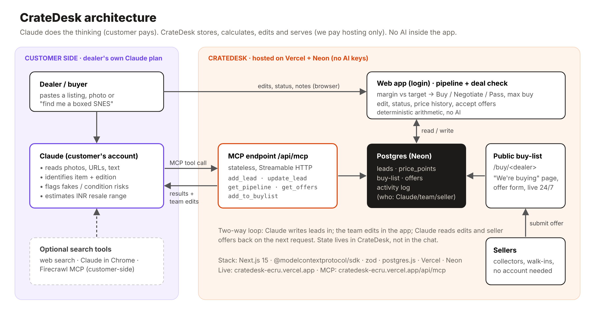

# CrateDesk: architecture and implementation notes

**The buying desk for collectibles dealers in India: retro gaming, vinyl and trading cards. It runs on the dealer's own Claude, and the app itself contains no AI.**

| | |
|---|---|
| **Live app** | https://cratedesk-ecru.vercel.app (login `volopay` / `crate2026`) |
| **MCP server** | `https://cratedesk-ecru.vercel.app/api/mcp` |
| **Public buy-list** | https://cratedesk-ecru.vercel.app/buy/groove-and-pixel |
| **Connect guide** | https://cratedesk-ecru.vercel.app/connect |
| **Source** | https://github.com/vikramadityaroxwithanx/Cratedesk |

## What it does

Dealers and resale shops source stock from OLX, Instagram, WhatsApp groups, estate sales and walk-ins. Every buy is a judgment call: what exactly is this, is it real, and what will it resell for? Today that knowledge sits in the owner's head and in WhatsApp threads.

The dealer's Claude reads the listing, photo or seller message, identifies the item and edition, flags authenticity and condition risks, and estimates a resale range in INR. It sends this to CrateDesk over MCP. CrateDesk runs the procurement side of the business:

- a **sourcing pipeline** with a deterministic margin check against the dealer's target
- **price history**
- **team editing and status tracking**
- a public **"We're buying" page** where sellers submit offers 24/7

## Architecture



### Data flow

1. **Request:** the dealer asks Claude, e.g. *"Here's an OLX listing for a boxed PAL SNES at ₹9,000. Add it to my CrateDesk pipeline. Is it worth buying for resale?"*
2. **Thinking (Claude):** Claude identifies the item and edition, estimates the resale range, and writes risk notes. It can use its own web search or browser to find listings.
3. **Write (MCP):** Claude calls `add_lead`. The server validates the input with zod and inserts a row in `listings`, the first `price_points` entry, and an `activity` record (actor = claude).
4. **Calculate (app, no AI):** expected margin = (resale midpoint − asking) ÷ resale midpoint. Compared with the target (default 30%), this gives **Buy / Negotiate / Pass**, plus the **max buy price** that would still hit the target.
5. **Human edit (web app):** the team logs in, edits price, notes and status, logs new prices, and accepts or declines offers. Each change is recorded with actor = human.
6. **Public intake (no login):** sellers submit offers on `/buy/<dealer>`, recorded with actor = seller.
7. **Read back (MCP):** `get_pipeline` and `get_offers` return the team's edits and the sellers' offers to Claude on the next request. Shared state lives in CrateDesk, not in the chat.

### MCP tools

| Tool | Type | What it does |
|---|---|---|
| `add_lead` | write | Save an item to buy, with Claude's identification, resale range and risk notes |
| `update_lead` | write | Change asking price (logged to history), status, estimate or notes |
| `delete_lead` | write | Permanently delete a lead and its price history when the dealer asks |
| `get_pipeline` | read | Read leads, computed margins and the team's edits; filter by category/status, or one lead with price history |
| `add_to_buylist` | write | Add an item to the public "We're buying" page |
| `get_offers` | read | Read offers sellers submitted on the buy-list |

### Data model

`listings` (leads) · `price_points` (price history per lead) · `wants` (public buy-list) · `offers` (seller offers) · `activity` (audit log: Claude / team / seller). Tables are created automatically on the first request.

## Responsibilities: CrateDesk vs partners

| Party | Responsible for | Who pays |
|---|---|---|
| **CrateDesk (us)** | MCP server and tool design; data model and storage; margin and verdict logic; web app (pipeline, deal check, editing, price history, offers); public buy-list; access control; uptime | — (our product) |
| **Anthropic, via the dealer's own Claude** | All AI work: reading photos, URLs and text; identifying items and editions; authenticity and condition judgment; resale estimates; optional web search or browsing; deciding which tool to call | **The dealer**, through their Claude plan. Free works with one custom connector; Pro/Max/Team allow more. |
| **Vercel** | Hosting the Next.js app and the MCP endpoint (serverless functions, TLS, deploys from GitHub) | Us: free Hobby tier for the demo, Pro (~US$20/mo) for commercial use |
| **Neon** | Managed Postgres database | Us: free tier for the demo, ~US$19/mo at scale |
| **GitHub** | Source control; triggers deploys | Free |
| **Optional customer-side tools** (web search, Claude in Chrome, Firecrawl MCP) | Finding listings | The dealer, if they use them |

**No AI inside.** CrateDesk holds no OpenAI, Anthropic or other model keys and makes no model calls. Margin, verdict and max-buy price are arithmetic.

## Tools used

- **App:** Next.js 15 (App Router, server actions), React 19, TypeScript
- **MCP:** `@modelcontextprotocol/sdk` 1.32, Web-standard Streamable HTTP transport, stateless, JSON responses; zod schemas
- **Database:** Postgres on Neon via `postgres.js`
- **Hosting:** Vercel (GitHub-connected)
- **Build process:** written with Claude's help as a coding assistant, which the brief allows. Tested end to end with scripted MCP calls and Playwright browser tests before deploying.

## Built vs proposed

| Built (v1, live now) | Proposed (production) |
|---|---|
| One demo dealer per deployment, one shared test login | Multi-tenant workspaces, roles (owner/buyer), per-workspace MCP URL |
| MCP endpoint open (no auth) so reviewers can test easily | OAuth 2.1 on the MCP endpoint, tied to the dealer's workspace |
| Resale ranges from Claude and the team | INR price index built from accepted offers and logged prices across dealers |
| Single target margin (env `TARGET_MARGIN`, default 30%) | Per-category targets, sell-side tracking (realised margin), inventory ageing |
| Offers stored in-app, dealer contacts seller | WhatsApp/email alerts on new offers; seller payouts and buyer spend cards (the Volopay angle) |
| No billing | Razorpay subscriptions: Free / Pro ₹499 / Business ₹1,499 per month |

**Simulated or limited in v1:**

- Nothing in the demo flow is mocked. Every lead, edit and offer is stored in the live database.
- The demo dealer "Groove & Pixel Collectibles" is fictional.
- Single tenant, open MCP endpoint, no notifications, no billing.
- Resale estimates are Claude's judgment, not a market dataset.

## Assumptions

- The dealer already uses Claude, or will use the Free plan, which supports one custom connector.
- Indian collectibles supply is fragmented across OLX, Instagram, WhatsApp and walk-ins, with no INR price reference.
- Buying happens off-platform (message the seller, pay by UPI or cash). CrateDesk records the decision and the outcome; it is not a shop and has no checkout.
- Claude's resale estimates are good enough as a starting point, and the dealer corrects them in the app.

## Limitations

- Claude's web search can't see logged-in or bot-blocked sites (Instagram, much of OLX). Dealers get the best results by pasting the listing or a screenshot, or by using Claude in Chrome.
- The verdict is only as good as the resale range entered.
- The open MCP endpoint means anyone with the URL can write to the demo pipeline. This is acceptable for review only.

## Next steps

1. Dealer accounts plus OAuth on MCP, so each dealer gets a private connector.
2. Offer alerts on WhatsApp/email, and "convert offer to lead".
3. Track sell price and realised margin to close the buy → sell loop.
4. Pilot with 10 dealers (card shows, record fairs, Instagram resellers) and measure leads logged per week and avoided overpays.
5. Razorpay billing. Then the INR price index and payments.

## Run locally

```bash
cp .env.example .env.local   # set DATABASE_URL to any Postgres
npm install && npm run dev
```

## Deploy (Vercel)

1. Import this repo in Vercel (**Add New → Project**).
2. **Storage → Create Database → Neon**, connect with env prefix `DATABASE` (so the variable is `DATABASE_URL`), then redeploy.
3. Optional env vars: `DEMO_USER`, `DEMO_PASSWORD`, `DEALER_HANDLE`, `DEALER_NAME`, `DEALER_CITY`, `TARGET_MARGIN`.
4. The MCP URL is `https://<project>.vercel.app/api/mcp`.
