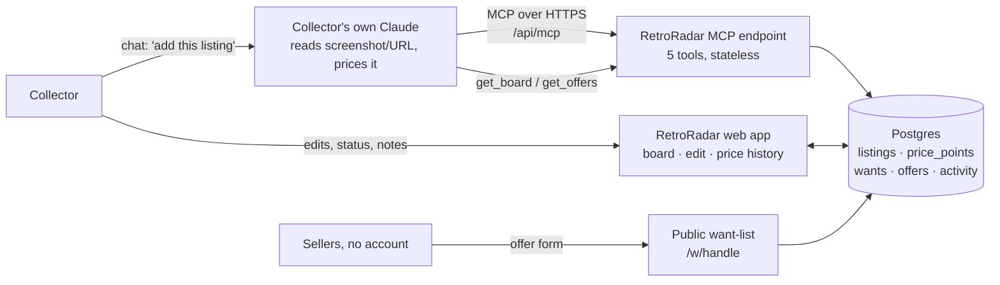

# RetroRadar

**A sourcing board for retro console collectors in India. It runs on the customer's own Claude, and the app itself contains no AI.**

The collector's Claude reads listings (OLX, Instagram, eBay…), estimates a fair Indian price and flags red flags. Claude sends the result to RetroRadar over MCP. RetroRadar stores it, keeps price history, lets the collector edit everything, and hosts a public want-list page where sellers submit offers. It keeps working after the chat ends.

## Connect it to Claude

1. In Claude, go to **Settings → Connectors** (also under **Customize → Connectors**).
2. Click **Add custom connector**. Name it `RetroRadar` and paste `https://<your-app>/api/mcp`. No OAuth is needed.
3. In a new chat, switch on RetroRadar in the tools menu.
4. Try: *"Here's an OLX listing: Super Nintendo PAL, boxed with 2 controllers, ₹14,500, Pune. Add it to my RetroRadar board and tell me if it's fairly priced."*
5. Open the app. The listing is on the board. Edit it, then ask Claude to "check my board" and it sees your edits.

| Tool | What it does |
|---|---|
| `add_listing` | Save a listing with Claude's fair-price range and assessment |
| `update_listing` | Change price (logged to history), status, notes |
| `get_board` | Read all listings or one with price history, including the owner's edits |
| `add_want` | Add an item to the public want-list |
| `get_offers` | Read offers sellers submitted on the public page |

## Architecture



**Data flow.** Claude → MCP tool call → validation (zod) → Postgres → board UI. The collector's edits go back to Postgres, and Claude reads them on the next `get_board` call. Sellers write offers through the public page, and Claude reads them with `get_offers`.

**Who does what**

| The customer's Claude (customer pays) | RetroRadar (we pay hosting only) |
|---|---|
| Reading screenshots, URLs and listing text | Storing listings, price history, wants, offers |
| Estimating a fair price, spotting red flags | Deterministic verdict (asking price vs fair range) |
| Writing notes and seller questions | Editing UI, status pipeline, activity log |
| Comparing offers against budget | Public want-list and seller offer form, live 24/7 |

**No AI inside.** The app has no OpenAI or Anthropic keys and makes no model calls. The "Below market / Fair / Above market" verdict is simple arithmetic.

## Stack

Next.js 15 (App Router, server actions) · Postgres (Neon via Vercel) via `postgres.js` · `@modelcontextprotocol/sdk` 1.32 with the Web-standard Streamable HTTP transport (stateless, JSON responses) · zod · hosted on Vercel. Tables are created automatically on the first request.

## Built vs proposed

| Built (v1, live) | Proposed (production) |
|---|---|
| Single collector per deployment, one shared test login | Multi-tenant accounts, a per-user MCP URL with OAuth |
| MCP endpoint is open (no auth) for easy reviewer testing | OAuth 2.1 on the MCP endpoint, tied to the user's board |
| Prices come from Claude and the user | Optional INR price index built from accepted offers and logged prices across users |
| Offers stored in-app | WhatsApp/email notifications on new offers |
| | Paid tier: unlimited listings, multiple public lists, price-drop reminders |

**Simulated or limited in v1:** nothing in the demo is mocked. Limitations: one collector per deployment, the MCP endpoint is unauthenticated, no notifications, and the fair-price range is Claude's estimate rather than a market dataset.

**Assumptions:** the collector has Claude (Free allows one custom connector; Pro and up allow several). Indian retro supply is spread across OLX, Instagram and WhatsApp groups with no INR price reference.

## Run locally

```bash
cp .env.example .env.local   # set DATABASE_URL to any Postgres
npm install && npm run dev
```

## Deploy (Vercel)

1. Push this repo to GitHub, then in Vercel choose **Add New → Project** and import it.
2. In the project, go to **Storage → Create Database → Neon (Postgres)** and connect it. `DATABASE_URL` is added automatically.
3. Optional env vars: `DEMO_USER`, `DEMO_PASSWORD`, `COLLECTOR_HANDLE`, `COLLECTOR_NAME` (defaults: `volopay` / `retro2026` / `vikram` / `Vikram`).
4. Redeploy. The MCP URL is `https://<project>.vercel.app/api/mcp`.
